<div align="center">


# Riaya · رعاية
### A private front door to men's reproductive health

**Arabic-first · voice-first · locked by default · built for Abu Dhabi**

[**Try it live**](https://riaya-xhby.onrender.com) · [**Demo video (English)**](https://youtu.be/9WLX1obk9Z8) · [Demo video (Arabic)](https://youtu.be/UkW8BvTJ8Gw) · [Download Android & Mac apps](https://github.com/yugesh1111/riaya/releases/tag/v1.0.0) · [Impact simulator](https://riaya-xhby.onrender.com/impact.html) · [Privacy map](https://riaya-xhby.onrender.com/privacy-map.html) · [Security](docs/SECURITY.md)

</div>

> In the UAE, a man's side of fertility is usually looked at last, often after a year or more of trying, and many men never talk about it at all. Riaya lets him check privately in three minutes, by voice in Gulf Arabic or English. It explains what it found and shows what to change first. A doctor approves every referral, the specialist sends the visit summary back, and he controls who sees what at every step.

<p align="center">
  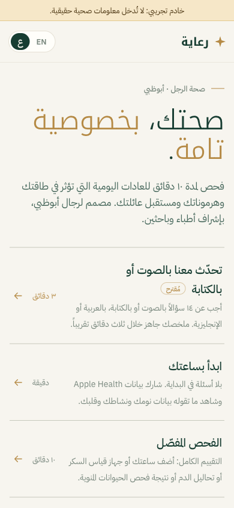
  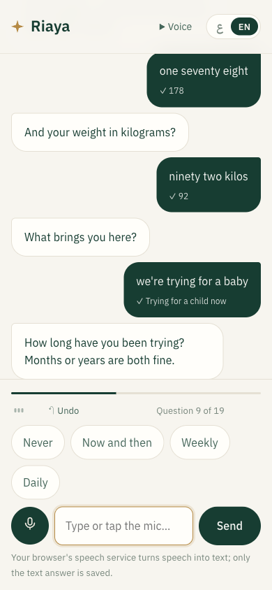
  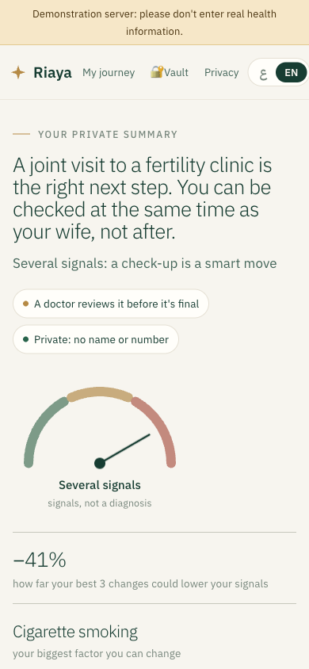
  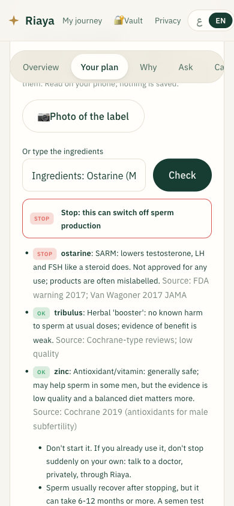
  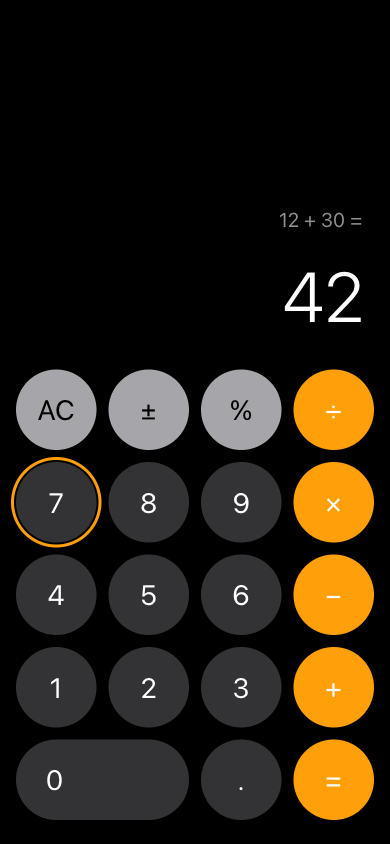
</p>

## 🏆 Why Riaya stands out: the top 12, ranked

| Rank | Feature | Why it matters |
|:-:|---|---|
| 1 | **Calculator cover + locked by default** | Picked up by mistake, it's a calculator. His PIN then "=" opens Riaya. Built for a subject men hide. |
| 2 | **Talk it through, in Gulf Arabic** | Speaks and listens in Emirati, Saudi, Egyptian and Levantine Arabic, and English. Understands "سنة ونص" = 18 months. Can run fully on the phone. |
| 3 | **Encrypted vault, re-confirm per document** | Reports never leave his phone (AES-256). Each one asks for Face ID again before it opens. Doctors have their own vault. |
| 4 | **He is told every time his record is opened** | A private message whenever a doctor or clinic opens his summary, labs or referral, plus one switch that pauses all sharing. |
| 5 | **Gym product checker** | Photograph a supplement label. Testosterone, steroids and SARMs are flagged because they switch off sperm production, a common and reversible cause in young men who train. |
| 6 | **Prescriptive + predictive** | His best three changes (effect × evidence ÷ effort), a 12-week projection, and lab trends forecast to his next test with early alerts. |
| 7 | **Closed-loop referral** | Doctor approves → he books, calls or WhatsApps the clinic → the specialist sends the summary back. Deadlines by urgency, escalation, and the referral published as a FHIR R4 Task. |
| 8 | **Explainable, never a black box** | Every finding shows what we saw, why it matters (evidence graded A–D, 95 sources), what helps and its limits. Guardrails for urgent symptoms, doses and "am I infertile?". |
| 9 | **Behaviour change that lasts** | 12-week companion on COM-B and BCT Taxonomy v1: WHO-5 at day 0/30/84, well-timed nudges, a fresh start after a lapse, Ramadan mode. |
| 10 | **Watch first + UAE heat guard** | Apple Watch / Wear OS / Garmin data first. Today's heat in his emirate becomes one tip, and his location never leaves the phone. |
| 11 | **Impact simulator for the health authority** | "Offer it to 20,000 men → ~1,470 more men assessed a year, ~2,310 years of waiting removed", with every assumption visible and adjustable. |
| 12 | **Runs everywhere** | Web app on iPhone, Android APK, Mac app, WhatsApp. Doctors use the same app. Accessibility check (WCAG 2.2 AA) passes on the main pages. |

## 🔒 Privacy, side by side

<p align="center">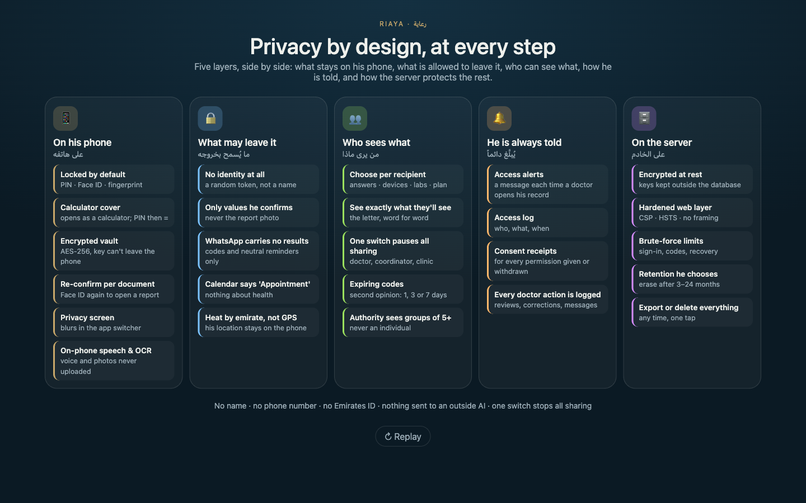</p>

| 📱 On his phone | 🔒 What may leave it | 👥 Who sees what | 🔔 He is always told | 🗄 On the server |
|---|---|---|---|---|
| Locked by default (PIN · Face ID · fingerprint) | No identity: a random token, not a name | Choose what each recipient sees | Access alerts every time a doctor opens his record | Encrypted at rest; keys outside the database |
| Calculator cover (PIN then =) | Only lab values he confirms, never the photo | See the letter word for word before sharing | Access log: who, what, when | Content Security Policy, HSTS, no framing |
| Encrypted vault, Face ID per document | WhatsApp carries codes and neutral reminders only | One switch pauses all sharing | Consent receipts | Brute-force limits on sign-in and codes |
| Privacy screen in the app switcher | Calendar entries say only "Appointment" | Expiring second-opinion codes (1, 3 or 7 days) | Every doctor action logged | Retention he chooses (3–24 months) |
| On-phone speech and photo reading | Heat by emirate, never GPS | Health authority sees groups of 5+ only | | Export or delete everything, any time |

## 🎥 See every feature working

<p align="center">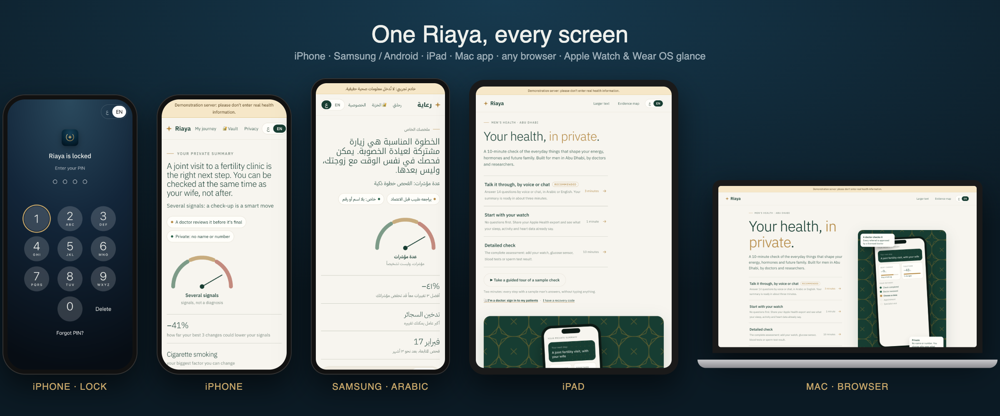</p>

Every clip below was recorded from the running app. The full-quality videos are in [`docs/videos/`](docs/videos).

| | |
|:-:|:-:|
| **Talk it through (voice or typing)**<br>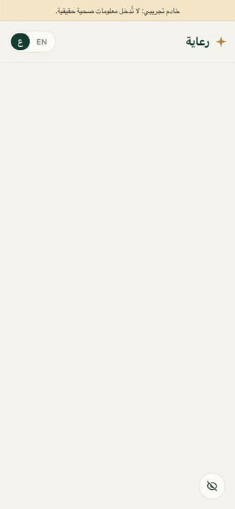<br>Understands "one seventy eight", "a year and a half", even a misheard "dayly"; shows what it understood; one-tap Undo | **Arabic first, four accents**<br><br>Emirati · Saudi · Egyptian · Levantine, or English |
| **First-time setup**<br>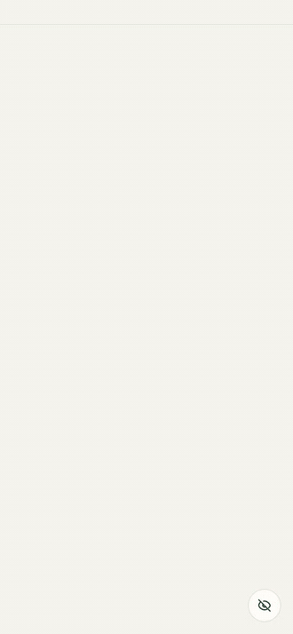<br>Choose a normal lock or the calculator cover, set a PIN, then Face ID as its own step | **Calculator cover**<br>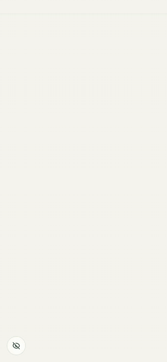<br>A working calculator; 12 + 30 = 42; the PIN then "=" opens Riaya |
| **Minimise → blur → locked again**<br><br>Blurred in the app switcher, one-tap hide, the lock on return | **Native locks**<br>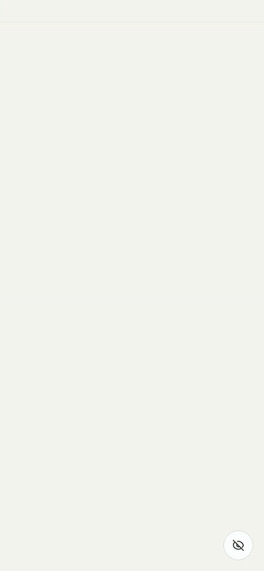<br>iPhone-style and Samsung-style keypads, ع \| EN switch |
| **Explained summary**<br><br>What we saw, why it matters, evidence A–D, limits | **Best changes + 12-week projection**<br><br>Switch changes on and off; the forecast redraws |
| **Photo of a gym product label**<br><br>Read on the phone; Ostarine flagged STOP with the evidence | **Type a product instead**<br><br>Testosterone, steroids, SARMs, banned stimulants |
| **UAE heat guard**<br><br>Today's heat by emirate, never GPS | **Watch first**<br><br>Apple Health export, then Apple Watch and Wear OS faces |
| **Lab dashboard and forecast**<br><br>Each lab's own range, next test due, projected value | **12-week companion**<br><br>WHO-5, behaviour-change techniques, Ramadan mode |
| **Encrypted vault**<br><br>Face ID / PIN again for each document | **Privacy controls**<br><br>See the letter word for word, pause all sharing, choose retention |
| **Doctor console + closed-loop board**<br>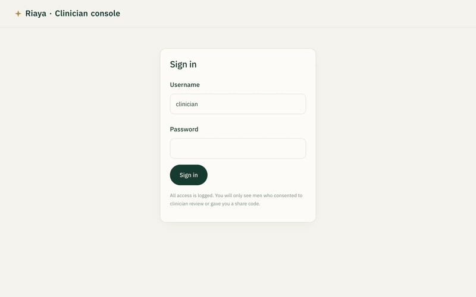<br>Review queue, deadlines by urgency, escalation, FHIR Task | **Dashboard + impact simulator**<br>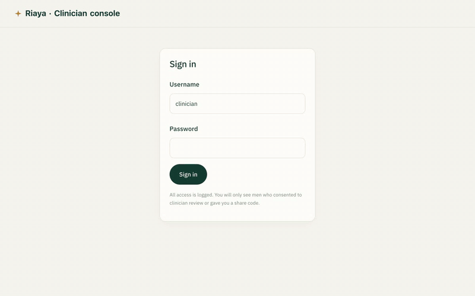<br>k-anonymised outcomes; what a rollout could change |
| **Privacy map**<br>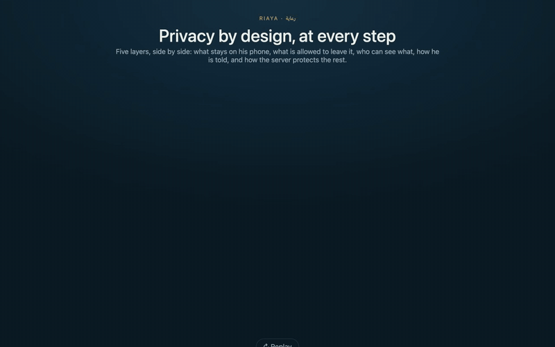 | **How it works**<br>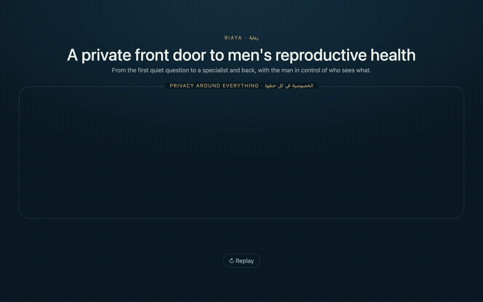 |
| **Arabic landing, ع \| EN switch**<br> | |

## 🎬 Screens

| | | | |
|:-:|:-:|:-:|:-:|
| 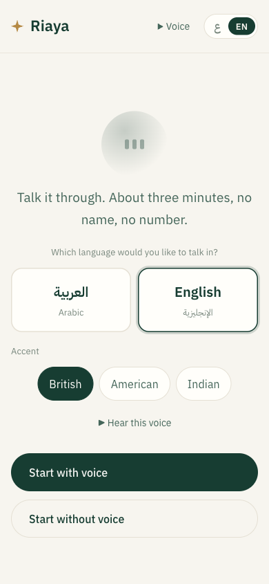<br>Voice: language and accent | 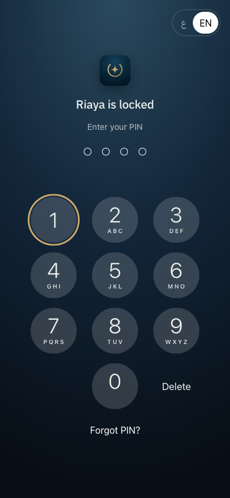<br>iPhone-style lock | 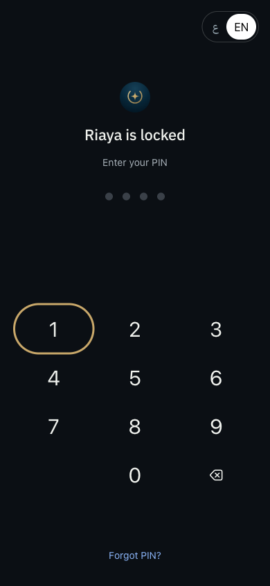<br>Samsung-style lock | 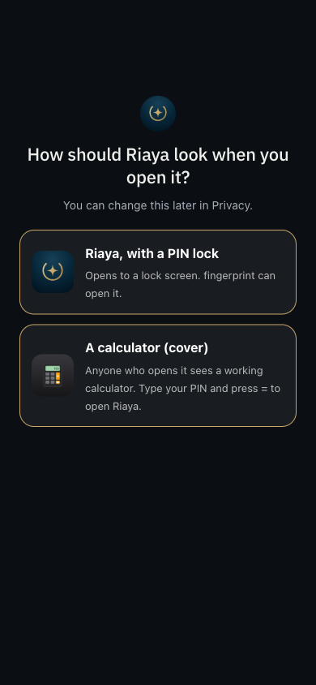<br>Choose the cover |
| 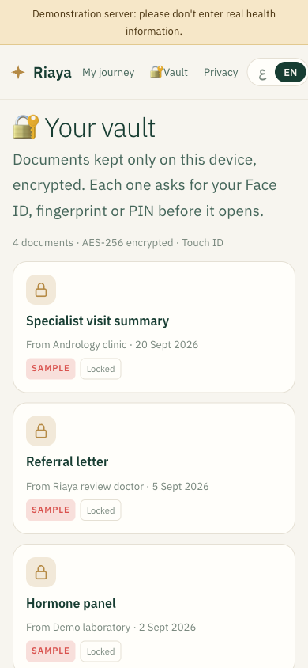<br>Encrypted vault | 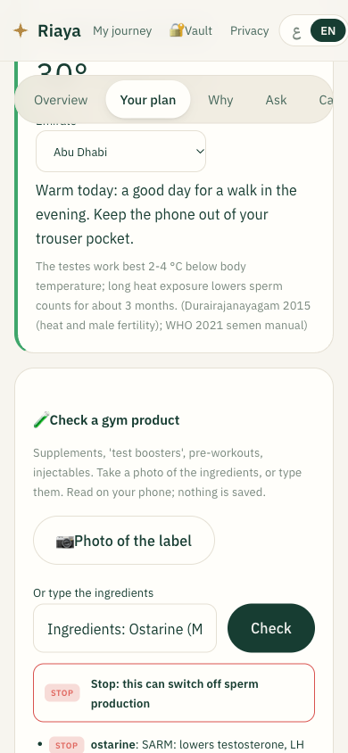<br>UAE heat guard | 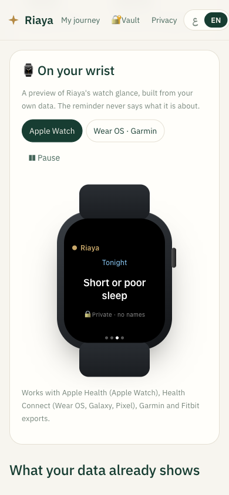<br>On your wrist | 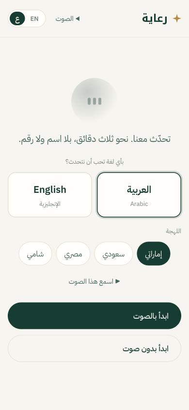<br>Arabic first |
| <br>Closed-loop board | 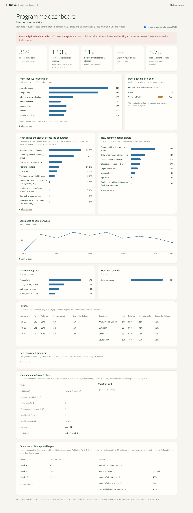<br>Programme dashboard | 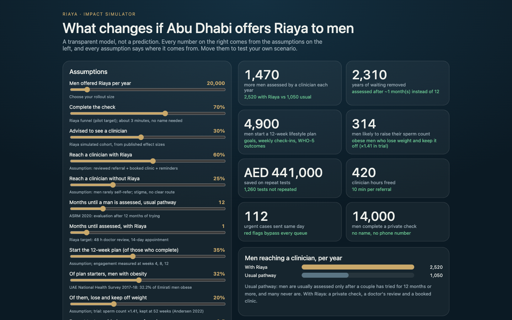<br>Impact simulator | 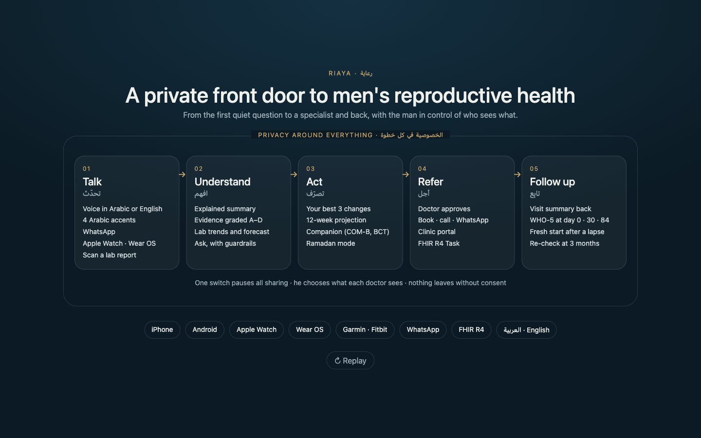<br>How it works |

## ✅ Proof it works

| Check | Result |
|---|---|
| Automated API tests | **79 pass** (`backend/tests`) |
| Red flags escalated | **5 / 5** (`validation/SCENARIOS.md`) |
| Adversarial questions caught by guardrails | **30 / 30** |
| Unsupported claims in companion answers | **0 / 78** |
| Consent and revocation checks | **15 / 15** |
| Voice demo: recorded answers recognised on the phone (English) | **19 / 19** |
| Accessibility (axe-core, WCAG 2.2 AA) | **No violations** on the main pages |
| Real usability testing (System Usability Scale) | Live at [/tester.html](https://riaya-xhby.onrender.com/tester.html); results on the dashboard |


## 📋 Every feature, by category

Riaya works in any browser and installs on **iPhone, Android and Mac**: as a web app from the browser, as an Android APK, or as a Mac app (DMG). It is Arabic first and fully in English too. Status: ✅ working and tested · 🟡 ready but not connected to a real-world service.

### 🔒 Security and privacy
| # | Feature | What it does | Status |
|---|---|---|---|
| S1 | No identity needed | No name, phone, email or Emirates ID. A random token on his phone, and a recovery code to move phones | ✅ |
| S2 | Locked by default | A PIN is required after his first summary. Every opening, and every return after 15 s away, shows the lock. The PIN is stored only as a PBKDF2 hash, and wrong tries pause input | ✅ |
| S3 | Face ID / Touch ID / fingerprint | Offered as its own step after the PIN, named for the device (Face ID on iPhone, Touch ID on Mac, fingerprint on Android), checked on the phone | ✅ |
| S4 | Native-looking lock | iPhone/Mac: an iOS-style passcode pad with letters. Samsung/Android: a flat One UI keypad. Both with an ع \| EN switch | ✅ |
| S5 | Document vault | His reports and doctor documents live only on his device, encrypted (AES-256-GCM, non-exportable key). Each one asks for Face ID or the PIN again to open, and closes when he leaves the app. Doctors have their own vault | ✅ |
| S6 | Calculator cover | At first setup he chooses: a normal PIN lock, or a calculator cover. With the cover, Riaya opens as a working calculator (even the tab title says "Calculator"); his PIN then "=" opens Riaya. Wrong PINs look like ordinary numbers. Switch it on or off in Privacy | ✅ |
| S7 | Told when someone opens his record | A private message every time a doctor or clinic opens his summary, labs or referral: who, what and when | ✅ |
| S8 | One switch pauses all sharing | Doctor, coordinator and clinic lose access at once; appointments stay | ✅ |
| S9 | Choose what each recipient sees | Answers, devices, labs and plan, per recipient. Applies at once, even to codes already given | ✅ |
| S10 | See exactly what they'll see | The referral letter word for word, updating live as he ticks boxes | ✅ |
| S11 | Access log and consent receipts | Who opened his record, and a receipt for every permission given or withdrawn | ✅ |
| S12 | Retention he chooses | Until he deletes it, or 3–24 months after his last visit, then erased | ✅ |
| S13 | Privacy screen | One tap hides the app behind a neutral wellness card; the screen blurs in the app switcher | ✅ |
| S14 | Server hardening | Encrypted at rest, strict Content Security Policy, HSTS, no framing, limits on wrong sign-ins and codes, no caching of health data | ✅ |
| S15 | Second-opinion codes | He picks the parts to share and how long the code lasts (1, 3 or 7 days); view only | ✅ |
| S16 | Export and delete | Download everything; delete everything | ✅ |
| S17 | Privacy map | `/privacy-map.html`: all privacy layers side by side, animated for presentations | ✅ |

### 🧭 Usability and accessibility
| # | Feature | What it does | Status |
|---|---|---|---|
| U1 | Talk it through (voice) | The check as a conversation. He speaks, and Riaya understands and replies out loud | ✅ |
| U2 | Language and accent | Arabic or English, then Emirati, Saudi, Egyptian or Levantine (or British, American or Indian English) | ✅ |
| U3 | Natural voices | Uses the device's most natural voice, speaks sentence by sentence, and has a "hear this voice" preview | ✅ |
| U4 | On-phone speech (private mode) | Whisper runs in the browser, so audio never leaves the phone | ✅ |
| U5 | Spoken numbers and dialect | "one seventy eight" = 178, "سنة ونص" = 18 months, "ما عندي مانع" = yes. A half-heard answer is asked again, never guessed | ✅ |
| U6 | ع \| EN switch everywhere | A two-part language switch on every page and on the lock screen | ✅ |
| U7 | Guided tour and voice demo | A 2-minute tour of a sample check; `chat.html?demo=en` / `?demo=ar` plays a recorded man's answers, recognised on the phone | ✅ |
| U8 | Accessibility | Automated WCAG 2.2 AA audit with no violations, keyboard and screen-reader support, reduced motion, bigger text | ✅ |
| U9 | Doctors use the same app | "I'm a doctor" on the start screen opens the clinician console, which has its own lock | ✅ |
| U11 | Tester feedback | `/tester.html`: 2 minutes, anonymous, Arabic or English. Uses the System Usability Scale (SUS) plus Riaya questions (clear, private, voice, would use, recommend). Results appear on the programme dashboard | ✅ |
| U10 | WhatsApp check | The same check over WhatsApp | 🟡 needs a Twilio number |

### 🧠 Explainable, predictive and prescriptive intelligence
| # | Feature | What it does | Status |
|---|---|---|---|
| I1 | Explained summary | What we saw, why it matters, evidence grade, what helps, limits | ✅ |
| I2 | Evidence map | 69 factors, 148 graded links, 95 references | ✅ |
| I3 | Ask about your summary | Answers only from his summary and the evidence; guardrails for urgent symptoms, medicines and "am I infertile?" | ✅ |
| I4 | Your best changes | Ranked by effect × evidence ÷ effort; the best three together | ✅ |
| I5 | 12-week projection | His signals if he does nothing, half or all of the plan | ✅ |
| I6 | Lab dashboard and forecast | Results in range, what is moving, next test due, a projected value with a likely range, and an alert before a limit is crossed | ✅ |
| I7 | Riaya-Net | Our own small model, fine-tuned on real data, runs on the phone; a clinician second opinion only | ✅ |
| I8 | Dropout early warning | Coordinators see who may fall off the pathway, with reasons | ✅ |
| I9 | Gym product checker | Photo (read on the phone) or typed label → STOP / CAUTION / OK for testosterone, steroids, SARMs, prohormones, banned stimulants and self-run "PCT", each with why and the evidence; Arabic too; nothing stored | ✅ |
| I10 | Impact simulator | `/impact.html`: what a rollout changes (men assessed, waiting removed, repeat tests avoided, clinician hours), every assumption sourced and adjustable | ✅ |

### 📱 Devices and tests
| # | Feature | What it does | Status |
|---|---|---|---|
| D1 | Watch first | Apple Health export first: what the watch alone suggests | ✅ |
| D2 | On-your-wrist preview | His own data on an Apple Watch face and a round Wear OS / Garmin face | ✅ |
| D3 | Other devices | Health Connect, Garmin, Fitbit, Dexcom/Libre CGM, CSV, with a personal baseline | ✅ |
| D4 | Scan a lab report | Photograph each page; auto-enhanced, read on the phone (EN + AR), joined into one encrypted PDF filed by date | ✅ |
| D5 | Lab report reading | Keeps each lab's printed range, reads his age, scores reading confidence; he corrects before saving; a doctor checks each value | ✅ |
| D6 | Semen analysis, hormones, metabolic | WHO 2021 limits; testosterone, LH, FSH, HbA1c, vitamin D; genomic flag | ✅ |
| D7 | Clothing check | Reads a care label and gives a groin-heat index | ✅ |
| D8 | UAE heat guard | Today's heat in his emirate (picked, never GPS) turned into one practical tip | ✅ |

### 🔁 12-week companion (behaviour change)
| # | Feature | What it does | Status |
|---|---|---|---|
| C1 | Goals and weekly check-ins | Up to 3 goals from his own drivers, doctor-reviewed, with trend charts | ✅ |
| C2 | WHO-5 outcomes | Day 0, ~30 and ~84; a 10-point change counts as meaningful; a low score offers a doctor and 800HOPE | ✅ |
| C3 | Behaviour-change design | COM-B targets and BCT Taxonomy v1 techniques for each goal | ✅ |
| C4 | Just-in-time nudges | At most one well-timed nudge; never at night or while fasting; every decision explained | ✅ |
| C5 | Fresh start after a lapse | One smaller goal and an if-then plan | ✅ |
| C6 | Ramadan mode | Fasting-aware goals, check-ins after iftar | ✅ |

### 🏥 Connected referral journey
| # | Feature | What it does | Status |
|---|---|---|---|
| R1 | My journey | Check → review → clinic → appointment → visit → summary → follow-up → re-check | ✅ |
| R2 | Doctor review | Every specialist referral approved, changed or rejected with a reason; rapid 24–48 h review | ✅ |
| R3 | Care Connect | Verified clinics, appointment requests, coordinator confirms | ✅ |
| R4 | Call / WhatsApp / save clinic | One tap to the clinic's official lines; save under a discreet name | ✅ |
| R5 | My own doctor | Pick from contacts (Android) or type the number (iPhone); send the handover code | ✅ |
| R6 | Clinic portal | The specialist opens the referral with a code, records the visit and messages him | ✅ |
| R7 | Get ready for your visit | Results to bring, test preparation, questions to ask | ✅ |
| R8 | Closed-loop tracking | Time limits by urgency, escalation, on-time rate | ✅ |
| R9 | FHIR R4 | Pre-screen bundle, referral letter, and the referral as a FHIR Task | ✅ (Malaffi/NABIDH/Riayati 🟡) |
| R10 | Messages, voice notes, video | Encrypted messages with the doctor; private video room | ✅ |
| R11 | Automatic reminders | One discreet message per stalled stage | ✅ |
| R12 | Visit ratings and partner mode | Ratings per clinic at 5+; a revocable link for his wife | ✅ |

### 📊 For the health authority
| # | Feature | What it does | Status |
|---|---|---|---|
| A1 | Programme dashboard | k-anonymised funnel, time to care, drivers, fairness, clinic ratings, 30+ day outcomes | ✅ |
| A2 | Doctor feedback on findings | Agree or disagree per finding, aggregated | ✅ |
| A3 | Validation | Triage vignettes, real-data model, calibration, fairness, measured scenario checks | ✅ |

### 📦 Platforms
| # | Platform | How | Status |
|---|---|---|---|
| P1 | iPhone / iPad | Safari → Add to Home Screen | ✅ |
| P2 | Android | `android/Riaya.apk` (Trusted Web Activity, built with Bubblewrap; one app with the calculator cover inside); or Chrome → Install | ✅ |
| P3 | Mac | `desktop/` builds `Riaya-1.0.0-arm64.dmg` (Electron) | ✅ |
| P4 | Any browser | https://riaya-xhby.onrender.com | ✅ |

See `docs/SECURITY.md` (attacks and protections), `docs/WELLBEING_QA_RESPONSE.md` (the organisers' Q&A briefing) and `docs/FEEDBACK_RESPONSE.md` (the review feedback).

## What's in it
- **Evidence graph** (`knowledge/graph.json`): 69 factors and 148 cause→effect links, each with an evidence grade (A–D) and a source (95 references). It also holds 23 measurable signals (watch, phone, CGM, questionnaire, lab) with thresholds, and 8 red flags. The graph drives scoring and explanations, and is validated at server start.
- **Intake** in Arabic and English, using validated instruments: STOP-Bang, AUDIT-C, PHQ-2, PSS-4 and ADAM.
- **Device data**: Apple Health export (sleep, steps, HRV, SpO2, glucose, caffeine, alcohol), Dexcom/Libre CGM CSV, a generic daily CSV (Fitbit/Garmin/Health Connect/screen time), or manual entry. Raw files are never stored.
- **Test results**: interpreted against WHO 2021 reference limits, from a lab report, a quantitative smartphone device (YO-type) or a simple home test.
- **Explainability**: Shapley attribution over the evidence graph, a gradient-boosting model with a SHAP waterfall (simulated cohort with literature effect sizes), and a logistic model trained on real data (UCI Fertility, n=100) as a second opinion.
- **Triage**: deterministic, ordered rules, each citing its guideline. Red flags override everything. Clinician approval is required for specialist referrals.
- **Clinician console**: review queue, case explanation, approve/modify, booking and attendance tracking, outcome and fairness metrics, access log.
- **IFHAS hand-off**: FHIR R4 Bundle export.
- **Privacy**: no identity data, granular consent, encryption at rest, revocable share codes, delete/export, audit log.
- **Care navigation**: after approval, a handover package (FHIR referral document plus a readable letter) for the receiving clinic. It includes results already available (so tests are not repeated) and the man's preferences.
- **Genomic flag**: automatic karyotype / AZF / CFTR and genetic-counselling flags for severe results, high FSH or a family pattern.
- **Rapid clinical review**: 24–48 h target with a live timer, encrypted patient–clinician messages, and a private video room.
- **Partner mode**: a revocable link that shows his wife only that he completed the check and the kind of next step.
- **Blood results and environment**: optional testosterone/LH/FSH/HbA1c/vitamin D entry, plus occupation and traffic/industry proximity.
- **Clothing check**: reads a care label (typed, or photographed with on-device OCR) and gives a groin-heat index with evidence-graded notes.
- **Voice and chat intake**: "Talk it through" in Gulf Arabic or English, with on-device understanding of spoken answers (`web/chat.html`, `js/nlu.js`, `js/voice.js`), and the same check over **WhatsApp** (Twilio webhook, with an in-app demo at `/whatsapp.html`). The phone number is never stored.
- **Watch first**: upload an Apple Health export and see what the devices alone suggest before answering anything, including a personal baseline (his last week against his own earlier weeks).
- **Lab Intelligence**: reads a lab report (PDF, photo via on-device OCR, or pasted text), keeps each lab's own printed range, scores reading confidence, checks how the sample was taken, and lets him correct values before saving. A results timeline shows each test against its own lab's range; a doctor accepts, corrects or sets aside each value.
- **12-week companion**: up to three goals from his own drivers, doctor-reviewed when he agreed to review, weekly check-ins with adherence and a measure, trends, and a discreet calendar reminder that says only "Weekly check-in".
- **Care Connect**: a verified clinic directory (official websites, who confirmed each clinic and when), appointment requests with preferred times, a coordinator who confirms the slot, a calendar entry that says only "Appointment", attendance and missed-visit reasons, and a one-time handover code for the clinic.
- **Programme dashboard** (`/insights.html`): k-anonymised funnel, time to care, drivers, prevalence, channels and fairness for ADPHC / DoH. Groups under 5 are hidden.
- **Recovery code**: restores his checks on a new phone with no name or number; the old device is signed out.

### Added after the review feedback (see `docs/FEEDBACK_RESPONSE.md`)
- **Private health companion**: a ladder of *safe next steps* (now, next weeks, 3 months, what not to do, when to get help sooner) and an *Ask about your summary* box. Answers are built only from his own summary and the evidence map, cite their evidence grade, and run three guardrails first (urgent symptoms, medicines and doses, "am I infertile?"). Nothing he types is stored or sent to an outside AI service.
- **Connected referral journey**: one pathway per check with eight stages (check, doctor review, clinic, appointment, specialist visit, visit summary, follow-up, re-check). The specialist records the visit outcome, tests ordered and the follow-up date; he sees it in his journey with a discreet follow-up calendar entry. A coordinator board shows where every man is and who has stalled, with a one-click private nudge.
- **Clinic portal** (`/clinic.html`): the receiving specialist opens the referral with his handover code (no account), sees only what he shared, records attendance and the visit summary, and messages him. Tests the specialist ordered become a checklist in his journey that ticks itself off when he saves the results. After the visit, his companion's next steps follow the specialist's plan.
- **Privacy switches**: one switch pauses all sharing (doctor, coordinator and clinic lose access at once; appointments stay booked), and he chooses how long his data is kept (until he deletes it, or 3–24 months after his last visit, then everything is erased).
- **Get ready for your visit**: once he has a clinic, a checklist built from his own summary: results to bring, how to prepare for a semen analysis (WHO 2021) or a morning testosterone test (Endocrine Society 2018), questions worth asking about his own top drivers, and his choices at the visit.
- **Automatic, discreet reminders**: one private message per stalled stage (and when his re-check is due), checked hourly. Never sent if he turned reminders off or paused sharing; the coordinator board shows who has been reminded.
- **Second-opinion codes**: he picks exactly which parts of his record a code shows and for how long (1, 3 or 7 days). The doctor opens it on the clinic page, view only.
- **Visit experience ratings**: three quick ratings after a visit (respect, privacy, explanation) plus "would you recommend". The programme dashboard shows averages per clinic only when 5 or more men have rated it.
- **See exactly what they'll see**: before sharing, he previews the referral letter word for word as the doctor or clinic receives it (built by the same code that builds their view), and the preview updates live as he ticks boxes. He can add the questions he wants to ask; they go at the top of the letter.
- **Your best changes (prescriptive)**: each change ranked by expected effect on his signals × strength of evidence ÷ effort, with a first step and when it shows; the best set of three is chosen together. **12-week projection (predictive)**: how his signals could move if he does nothing, follows the plan half the time, or fully; he switches changes on and off and the chart redraws. Signals only, never a chance of pregnancy.
- **Dropout early warning**: coordinators see who may fall off the pathway before they stall, scored from published predictors of missed care, with every reason shown.
- **Doctor feedback on findings**: clinicians agree or disagree with each explained finding (a reason is required to disagree); it is audited, shown to him in his access log, and aggregated to improve the explanations.
- **Riaya-Net** (`docs/RIAYA_NET.md`): our own small neural network, pre-trained on our simulated cohort and fine-tuned on real data, exported to run on the phone. Evaluated honestly; clinician second opinion only.
- **Guided tour**: a two-minute, auto-playing walk through a sample check with narration, spotlight and play/pause/skip, in Arabic and English.
- **Measured scenario checks** (`validation/SCENARIOS.md`): red flags, unsupported companion claims, adversarial questions, consent and revocation, referral packages, all counted by running them.
- **User-controlled sharing across the pathway**: he chooses, per recipient (Riaya review doctor, the clinic he picks), which parts of his record travel: answers, device data, lab results, plan. The summary always travels with a referral. Changes apply at once, including to handover codes already given. He sees every active share code, who opened his record (access log), and downloads consent receipts for every permission he gave or withdrew.

## Run it
```bash
python3 -m venv .venv && .venv/bin/pip install -r requirements.txt
.venv/bin/uvicorn app.main:app --app-dir backend --port 8000
```
- User app: http://localhost:8000 · Clinician console: http://localhost:8000/clinician.html (demo login `clinician` / `demo-clinician`; set `RIAYA_CLINICIAN_PASSWORD` for anything real) · Evidence map: /graph.html · Clothing check: /fabric.html · WhatsApp demo: /whatsapp.html · Programme dashboard: /insights.html · Clinic portal (handover code): /clinic.html · API docs: /api/docs

Settings (environment variables): `RIAYA_DATA_KEY` (Fernet key for encryption at rest; otherwise a key file is created in `data/`), `RIAYA_DB` (SQLite path), `RIAYA_CLINICIAN_PASSWORD`, `RIAYA_PUBLIC_URL` (used in WhatsApp links), `RIAYA_WHATSAPP_NUMBER` and `RIAYA_WHATSAPP_JOIN` (shown as a QR code), `RIAYA_TWILIO_AUTH_TOKEN` (checks Twilio webhook signatures), `RIAYA_VIDEO_BASE` (enables video rooms, e.g. a self-hosted Jitsi in the UAE), `RIAYA_UAE_HOSTED=1` (hides the demo banner).

```bash
.venv/bin/python -m pytest -q backend/tests          # end-to-end API tests
.venv/bin/python validation/run_validation.py         # writes validation/REPORT.md
.venv/bin/python validation/scenario_checks.py        # writes validation/SCENARIOS.md (measured end-to-end checks)
.venv/bin/python validation/run_validation.py --seed-demo   # also loads simulated cases into the console
```

## Docs
- `docs/FEEDBACK_RESPONSE.md`: each point of the review feedback and where it is answered in the product
- `docs/SECURITY.md`: every way someone could try to get at the data, what stops them, and what is still open
- `docs/WELLBEING_QA_RESPONSE.md`: the organisers' 10 Wellbeing Q&A questions, what is covered, what was added and what is still open
- `docs/VIDEO_PLAN.md`: the demo video plan and feature line-up
- `docs/Riaya_Submission.pptx` / `.pdf`: the challenge submission slides, filled in (team names and size to add)
- `docs/gifs/`, `docs/videos/`, `docs/shots/`: every feature recorded from the running app
- `docs/VIDEO_SCRIPT.md`: the narration to read, scene by scene with timings, in English and Arabic, plus Napkin AI text
- `docs/recovery/`: the API description captured from the live deployment, used to rebuild the backend after the repository was lost
- `validation/REPORT.md`: triage vignettes, real-data model, simulated cohort, calibration, fairness, pathway simulation, limitations
- `docs/RESEARCH_VERIFICATION.md`: every claim checked against the literature, including corrections
- `docs/CULTURAL_DESIGN.md`: each cultural/religious barrier and how the product handles it
- `docs/PRIVACY_AND_REGULATION.md`: applicable UAE rules and the controls in the code
- `docs/SYSTEM_LAYERS.md`: each gap Abu Dhabi has named, mapped to a working feature
- `docs/IFHAS_AND_ROADMAP.md`: integration, referral levels, pilot roadmap and value measures
